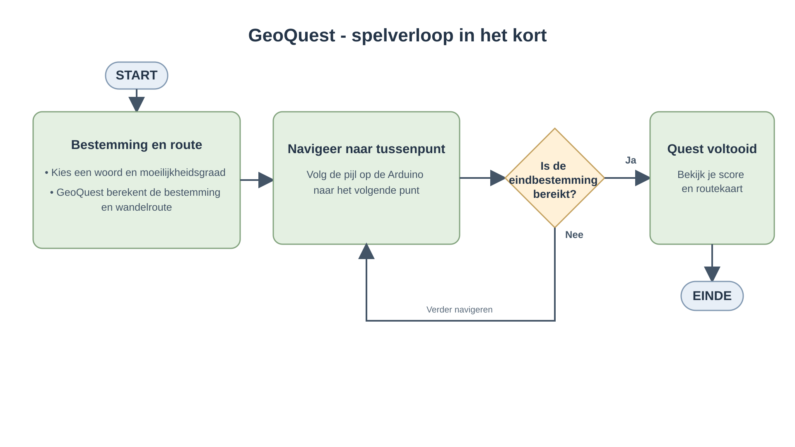
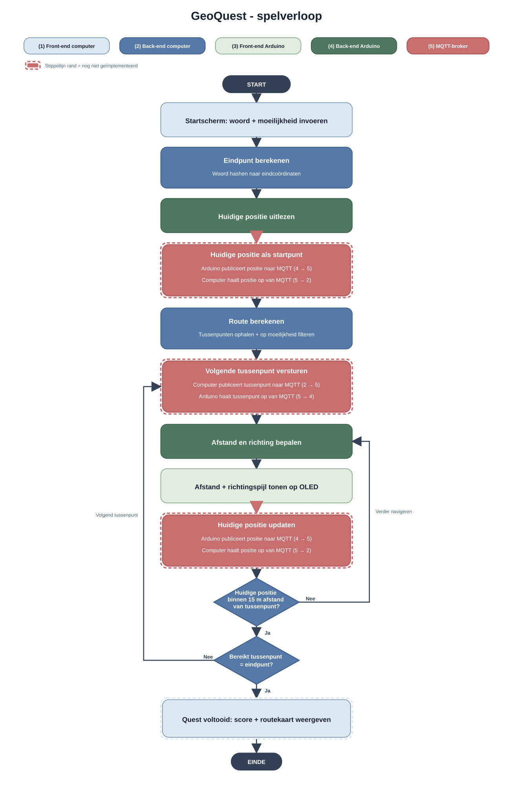

# MMM GeoQuest

## Spelverloop in het kort

## Technische flowchart

## Setup

- zet de `MAPBOX_TOKEN` in `.env`
- installeer `requirements.txt`: `pip install -r requirements.txt`

## Hoe uit te voeren

- arduino: open het `.ino` bestand in [Arduino IDE](https://www.arduino.cc/en/software/) en stuur het door
- python: run `python computer/main.py`
- pathfinding server:
  - clone en run [gpath](https://github.com/GrownPlanet/gpath), verdere instructies staan in de readme van dat project

## TODO's

### Computer

- [x] korste pad genereren
- [x] difficulty toepassen
- [x] MQTT server communicatie
  - [x] initiële locatie opvragen
- [x] difficulty vragen
- [x] main loop
- [ ] aantal punten in easy, medium, hard en expert bespreken
- [ ] grondig testen

### Arduino

- [ ] MQTT server communicatie
  - [ ] huidige punt ophalen
  - [ ] aankomst aangeven
- [x] richting naar volgende punt
- [ ] aankomst detecteren
- [x] richting aangeven op display

### Extra (indien er tijd over is)

- [ ] afgelegde weg tonen

## Communicatie-schema

De arduino en computer zullen via MQTT praten, de gebruikte server is `public.mqttserver.eu`. De arduino zal berichten sturen in `ugent/MMM/GeoQuest/arduino` en luisteren in `ugent/MMM/GeoQuest/computer` en vice versa.

De berichten die de arduino kan sturen zijn als volgt:

- `LOC(lon),(lat)`: de huidige locatie

De berichten die de computer kan sturen zijn als volgt:

- `NEXT(lon),(lat)`: de volgende locatie
- `LAST`: er zijn geen locaties meer

## Plan

Kort stappenplan code:

1. naam ingeven [x]
2. hashen [x]
3. omzetten naar locatie binnen Gent [x]
4. route aanvragen [x]
5. moeilijkheid selecteren [x]
6. aantal kruispunten op basis van moeilijkheid [x]
7. volgende punt wordt aan arduino gegeven
8. richting bepalen en weergeven [x]
   - door middel van gps en IMU [x]
9. aan punt gearriveerd? -> naar stap 7
10. aan laatste punt? /Geslaagd!/ score (tijd?) weergeven.

## File structure

- `snippets/`: snippets code die later nog handig kunnen zijn
- `arduino/navigator`: de broncode voor op de arduino
- `computer`: de broncode voor op de computer
- `media`: afbeeldingen voor en over het projects
- `.env`: environment variabelen
- `.env.example`: voorbeeld environment variabelen
